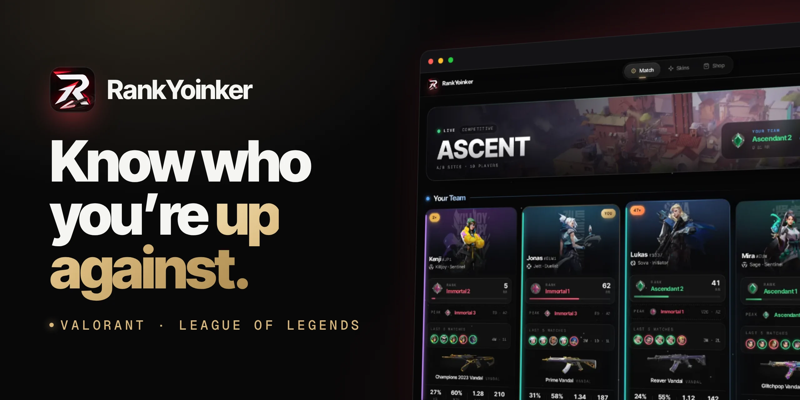
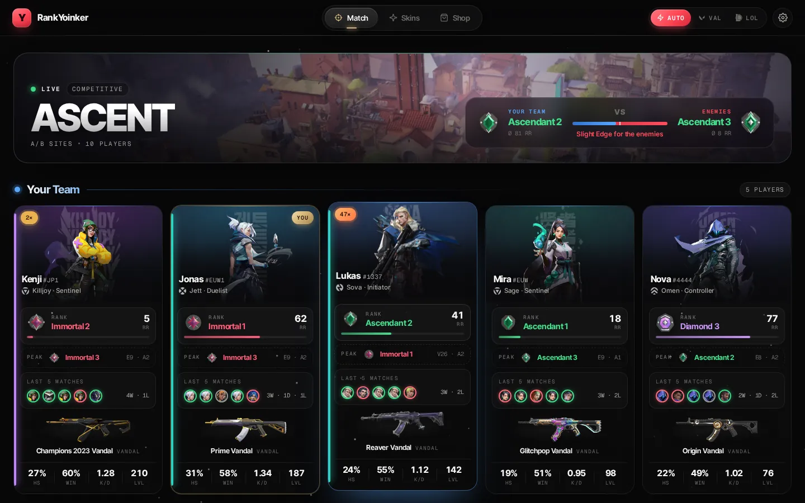
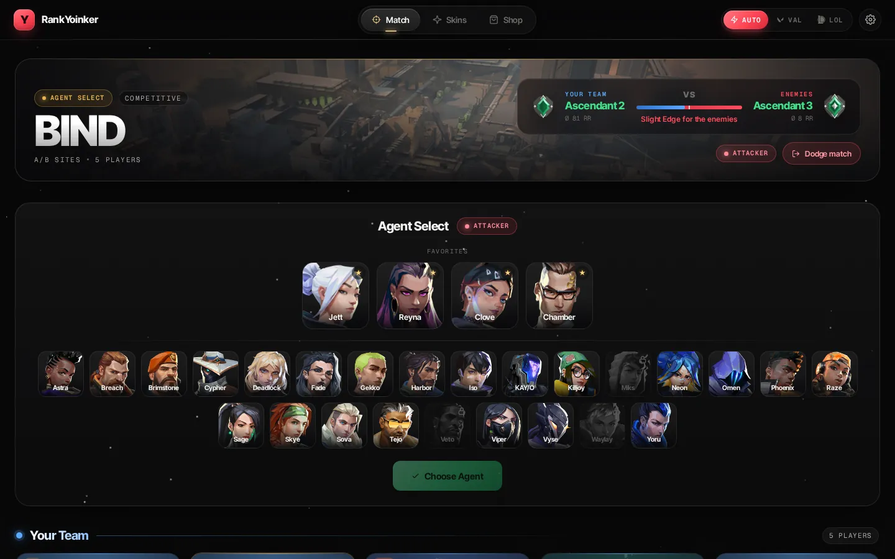
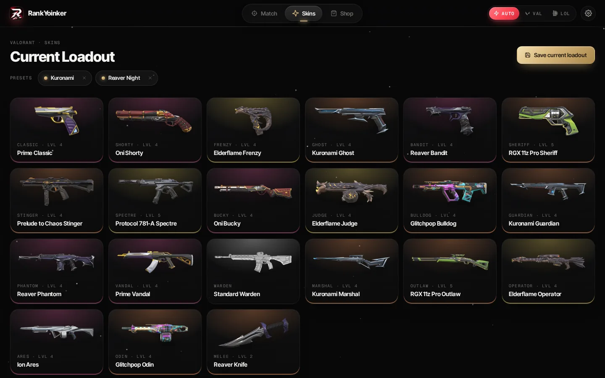
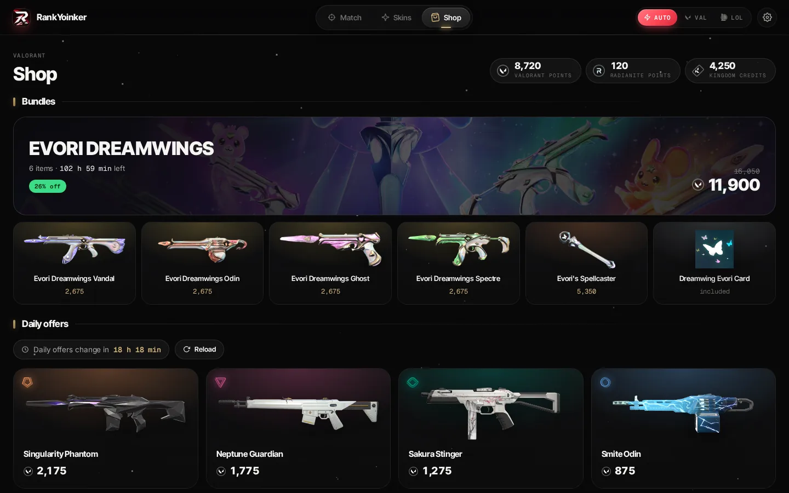
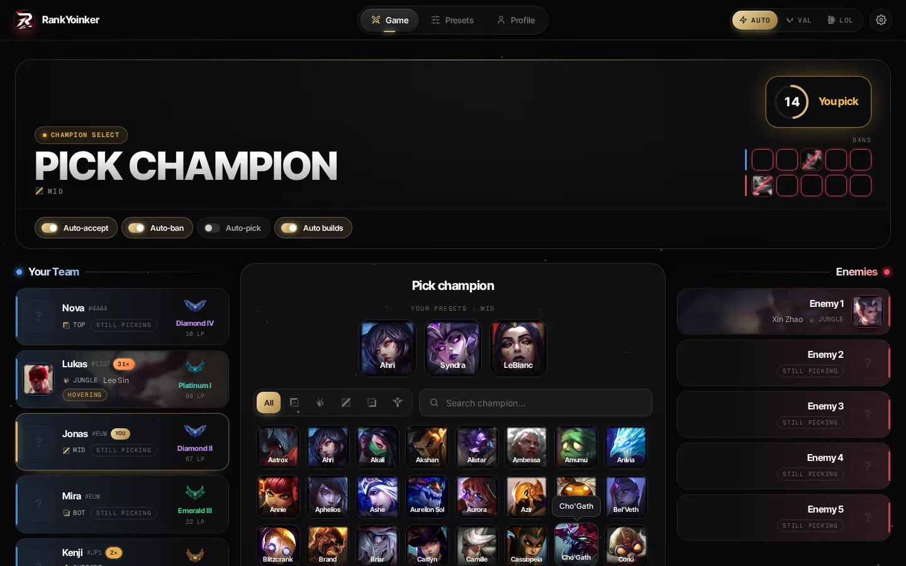
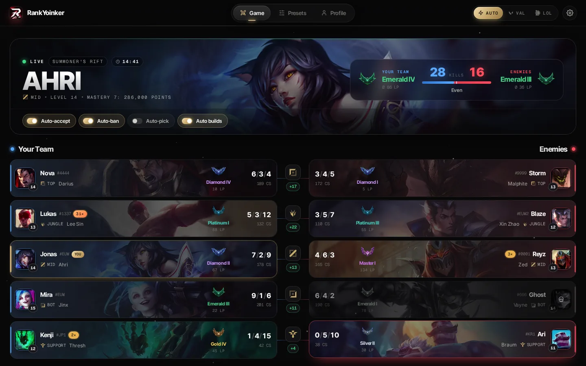

<div align="center">

<a href="https://rankyoinker.de"></a>

<br>

**Ranks, stats and parties of every player, live in your browser.**<br>
Plus instalock, auto pick, matchup builds, skins and your shop. One app for VALORANT and League of Legends.

<br>

[](https://github.com/zdruqz-js/rankyoinker/releases/latest)
[](https://github.com/zdruqz-js/rankyoinker/actions/workflows/build-release.yml)
[](https://github.com/zdruqz-js/rankyoinker/releases)
[](https://rankyoinker.de/discord)
[](setup/VRY-LICENSE.txt)

### [Download](https://rankyoinker.de/download) &nbsp;·&nbsp; [Website](https://rankyoinker.de) &nbsp;·&nbsp; [Live&nbsp;preview](https://rankyoinker.de/demo/) &nbsp;·&nbsp; [Discord](https://rankyoinker.de/discord)

<sub>Windows 10/11 &nbsp;·&nbsp; free,&nbsp;no&nbsp;ads &nbsp;·&nbsp; open&nbsp;source &nbsp;·&nbsp; 7&nbsp;languages</sub>

</div>

<br>

RankYoinker runs quietly in the background and fills in the overview on its own as soon as you play. There's no button to press and no overlay to toggle: open `http://rankyoinker` in any browser (or on your phone) and everything is there. It switches between VALORANT and League by itself.

## VALORANT

<table>
<tr>
<td width="50%"><br><sub><b>Live match</b>: every player's rank, stats and parties</sub></td>
<td width="50%"><br><sub><b>Agent select</b>: hover, lock and instalock from the browser</sub></td>
</tr>
<tr>
<td width="50%"><br><sub><b>Skins</b>: swap skins and save whole loadouts as presets</sub></td>
<td width="50%"><br><sub><b>Shop</b>: daily offers, bundles and the Night Market</sub></td>
</tr>
</table>

- **Live match overview.** Rank, peak, RR, win rate, K/D and the last five matches of all ten players, plus a team comparison showing who has the edge.
- **Agent select in your browser.** Hover and lock agents, pin favorites and dodge if you need to, right from the overlay.
- **Instalock.** Locks your agent after a random delay of 11 to 12 seconds, even with the tab closed.
- **Parties and encounters.** Duo and trio tags show who's playing together. Encounters reveal who you already know from earlier matches.
- **Smurf hint.** Low level but suspiciously strong stats? RankYoinker flags accounts that look off.
- **Skins and loadout presets.** Swap skins and save complete loadouts as presets, applied again with one click.
- **Shop and Night Market.** Daily offers, bundles and the Night Market with its discounts, without opening the game.
- **RR history and stats.** RR curve, headshot rate, damage per round and every match in detail.

## League of Legends

<table>
<tr>
<td width="50%"><br><sub><b>Champ select</b>: picks, bans, timer and auto pick/ban</sub></td>
<td width="50%"><br><sub><b>Live game</b>: lane matchups, kills, CS and ranks</sub></td>
</tr>
</table>

- **Draft-style champ select.** Picks, both teams' bans and the timer at a glance, with your presets as quick picks.
- **Auto ban and auto pick.** One target per lane plus two backup champions. If the main target is gone, RankYoinker takes the next one.
- **Matchup builds.** Runes, spells and item set tailored to your lane opponent. If you like, RankYoinker applies the build automatically.
- **Auto accept.** Accepts found games automatically. You'll never miss a queue pop again.
- **Live game.** Lane matchups, kills, CS and the ranks of all ten players while you play.
- **Profile and match history.** Solo/Duo and Flex rank, last season's peak, KDA, CS and all encounters.
- **Lobby and queue.** Start the queue, pick your lanes and keep an eye on the wait time.

## For both games

- 📱 **On your phone.** Pair via QR code and control everything from your phone on the same Wi-Fi.
- 🎮 **Discord Rich Presence.** Shows your game status on Discord automatically.
- 🌐 **7 languages.** German, English, Polish, French, Spanish, Turkish and Korean.
- 🔄 **One-click updates.** New versions arrive as a popup and are checked via SHA-256 before they install.

<p align="center"><sub>All screenshots come from the <a href="https://rankyoinker.de/demo/">live preview</a> with made-up players. Click through it yourself, no install needed.</sub></p>

## Get started

1. **Download** the installer from **[rankyoinker.de/download](https://rankyoinker.de/download)** or the [latest release](https://github.com/zdruqz-js/rankyoinker/releases/latest). If Windows shows a SmartScreen warning, click *More info* and then *Run anyway* (see [why](#faq)).
2. **Install.** The installer sets everything up: autostart, the short address `http://rankyoinker` and access for your phone.
3. **Play.** Start VALORANT or League and open `http://rankyoinker` in your browser. Everything else fills in on its own.

## Open and verifiable

You don't have to trust anyone blindly. You can check everything that matters yourself.

- **Source code.** Everything that ships is in this repo. You can read every line before you install.
- **Attested builds.** Every release is built by [GitHub Actions on a clean Windows runner](.github/workflows/build-release.yml), not on a personal machine, and carries a Sigstore build-provenance attestation. It proves that the exact `.exe` came from this repo, this commit and this workflow:

  ```sh
  gh release download <version> --repo zdruqz-js/rankyoinker --pattern "*.exe"
  gh attestation verify RankYoinker-SetupV<version>.exe --owner zdruqz-js
  ```

- **VirusTotal.** Every stable version is scanned on [VirusTotal](https://www.virustotal.com/). The download window on [rankyoinker.de](https://rankyoinker.de) shows the current result. The odd hit is a known false positive caused by normal installer behavior.
- **Verified updates.** The app only downloads updates from the official GitHub release and only installs them if the SHA-256 checksum matches.

## FAQ

<details>
<summary><b>Does RankYoinker cost anything?</b></summary>
<br>
No. RankYoinker is free and has no ads.
</details>

<details>
<summary><b>Can I get banned for using it?</b></summary>
<br>
RankYoinker uses the same interfaces the Riot Client uses to talk to Riot. It doesn't change any game files and doesn't read the game's memory. You still use automatic actions like instalock or auto pick at your own risk.
</details>

<details>
<summary><b>Why does Windows or my antivirus warn me?</b></summary>
<br>
The installer isn't signed with a paid certificate yet, so Windows SmartScreen shows a warning. A few antivirus scanners flag typical installer steps such as autostart as suspicious. You'll find the current VirusTotal report in the download window on the website, and the <a href="https://rankyoinker.de/discord">Discord FAQ</a> explains it in detail.
</details>

<details>
<summary><b>What data does the app send?</b></summary>
<br>
A random install ID, the app version and language, your linked Riot account, usage counters and error reports so bugs can be fixed. Everything else is in the <a href="https://rankyoinker.de/#datenschutz">privacy policy</a> (German).
</details>

<details>
<summary><b>How do I uninstall RankYoinker?</b></summary>
<br>
Just like any other app, via Windows Settings under Apps. Autostart, the firewall rule and the short address are removed along with it.
</details>

## What's in this repo

This is the actual source that ships to users, minus build output and runtime state:

| Path | What it is |
|---|---|
| [`index.html`](index.html) | The overlay itself: all UI and all client-side logic, one file, no build step. |
| [`vry_log_server.py`](vry_log_server.py) | The local backend the overlay talks to. Reads the local Riot Client and League Client session, proxies Riot's own APIs and serves `index.html` locally. |
| [`lang/`](lang) | One JSON file per language. Adding a language is just adding a file here. |
| [`setup/build_source/`](setup/build_source) | The Python source that gets frozen (via `cx_Freeze`) into `vry.exe`, the small process that hooks into VALORANT and League. The part most worth reading if you want to check there's nothing sketchy going on. |
| [`setup/install_all.py`](setup/install_all.py) / [`uninstall_all.py`](setup/uninstall_all.py) | What the installer actually runs: autostart, a firewall rule so your phone can connect, and the short address `http://rankyoinker` (plus the old `http://vry`) in the hosts file. Nothing else. |
| [`setup/RankYoinker.iss`](setup/RankYoinker.iss) | The Inno Setup installer definition. |
| [`.github/workflows/`](.github/workflows) | The CI pipeline described above, plus an installer upgrade test on a Windows runner. |

Not included: the embedded Python runtime (`.pyd`, `.dll`, `python.exe`; the stock python.org "embeddable" distribution, fetched fresh by CI), build output and any runtime state (logs, presets, your own `config.json`).

## Translations

Each language lives in [`lang/<code>.json`](lang) (about 500 strings) with the shape `{ "code", "label", "reviewedBy", "locale", "strings" }`. To fix or review a translation, edit the file and open a pull request. Once a native speaker confirms it, their name goes into `reviewedBy` and shows up as a ✓ in the language picker. The website texts aren't in this repo; if you'd like to review those too, say hi on [Discord](https://rankyoinker.de/discord).

## License and credits

Built on top of [VALORANT Rank Yoinker](https://github.com/zayKenyon/VALORANT-rank-yoinker) by Zay Kenyon and Contributors (ISC license). See [`setup/VRY-LICENSE.txt`](setup/VRY-LICENSE.txt) and [`frozen_application_license.txt`](frozen_application_license.txt).

<sub>RankYoinker isn't endorsed by Riot Games and doesn't reflect the views or opinions of Riot Games or anyone officially involved in producing or managing Riot Games properties. Riot Games and all associated properties are trademarks or registered trademarks of Riot Games, Inc.</sub>
